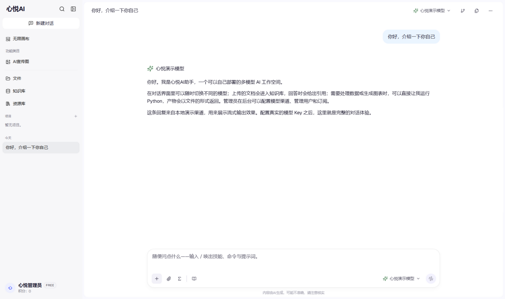
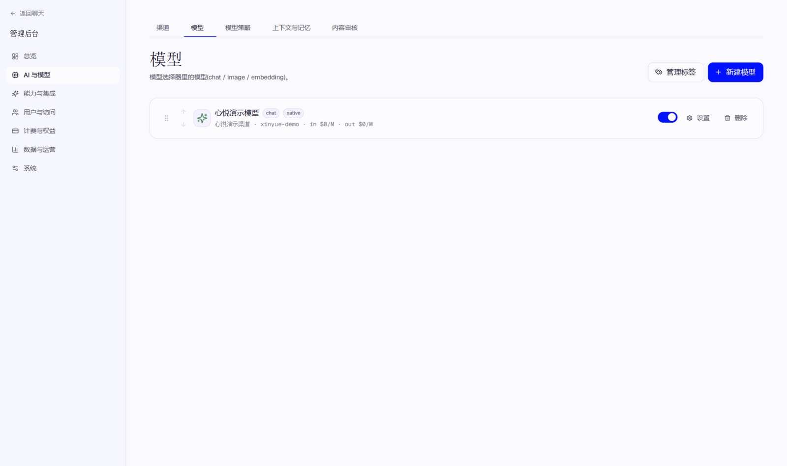
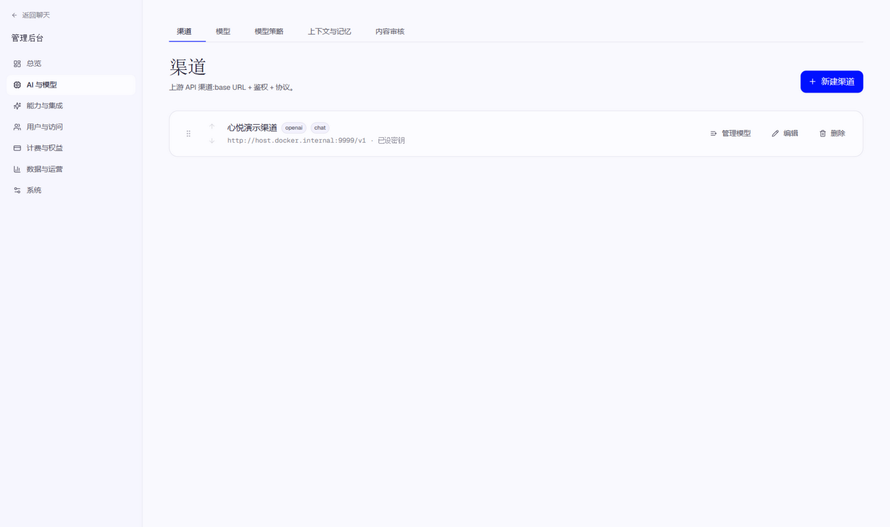

<h1 align="center">Xinyue AI Assistant · 心悦AI助手</h1>

<p align="center">
  <b>A self-hosted, multi-model AI workspace in a single container</b><br>
  Multi-model chat · Multi-turn tool calling · RAG knowledge base · Python sandbox · Team spaces · Quotas · Admin console
</p>

<p align="center">
  <a href="#quick-start">Quick Start</a> · <a href="#features">Features</a> · <a href="#common-environment-variables">Environment</a> · <a href="./README.md">简体中文</a>
</p>

<p align="center">
  
</p>
<p align="center">
  
  
</p>
<p align="center">
  
  
</p>

## Features

- **Multi-model chat**: Claude, GPT, Gemini, or any OpenAI-compatible endpoint in one UI; channels and keys are managed in the admin console, switch models per message.
- **Multi-turn tool calling**: Web search, page fetch, Python, image generation, memory, and skills chained automatically (48 calls per turn by default).
- **Knowledge base (RAG)**: PDF, Office, Markdown, spreadsheets, and images; structure-aware chunking, hybrid retrieval when a vector DB is configured, automatic full-text fallback otherwise, answers with citations.
- **Python sandbox (optional)**: One isolated workspace per conversation with pandas, matplotlib, python-pptx preinstalled; charts and documents become download cards; safe-mode arithmetic fallback when no sandbox is deployed.
- **Team workspaces**: Shared conversations, files, and knowledge bases with invite links and member attribution.
- **Subscriptions & quotas**: User tiers, daily limits, credits and redemption codes, optional payment gateways.
- **Admin console**: Channels, models, tools, users, knowledge bases, subscriptions, backups, and system settings in one place.

## Quick Start (single container)

**No need to install PostgreSQL / Redis / Qdrant first**: when these service URLs are unset, the app falls back to embedded SQLite, in-process cache, and full-text retrieval.

```bash
git clone https://github.com/qiantingwl/xinyueai-assistant.git
cd xinyueai-assistant

# Build the image (Vite SPA + Go API in one container)
docker build -f deploy/Dockerfile.app -t xinyueai-assistant:latest .

# Run
docker run -d --name xinyueai-assistant \
  -p 8787:8787 \
  -v xinyueai-data:/app/data \
  -e JWT_SECRET="$(openssl rand -hex 32)" \
  xinyueai-assistant:latest
```

Open `http://localhost:8787`:

1. The first visit lands on the setup page — **the first account you create becomes the admin**
2. Go to `/admin/channels` in the admin console, add a provider channel (API base URL + key), then create at least one chat model and set it as the default
3. Head back to the chat page and start talking; knowledge bases, files, and team spaces are managed from the same console

Conversations, uploads, and artifacts live in the `xinyueai-data` volume and survive image upgrades.

## Common Environment Variables

See [.env.example](.env.example) for the full list. The ones you'll touch most:

| Variable | Default | Description |
|---|---|---|
| `JWT_SECRET` | built-in placeholder (**change in production**) | Token signing secret, 32+ random bytes recommended |
| `DATABASE_URL` | embedded SQLite file | Set to `postgres://...` to switch to PostgreSQL |
| `REDIS_URL` | disabled | Enables Redis-backed cache, rate limiting, and cross-process stream notifications |
| `QDRANT_URL` | disabled | Enables vector search (hybrid RAG retrieval + dynamic top-K) |
| `SANDBOX_BASE_URL` / `SANDBOX_API_KEY` | disabled | Point at a sandbox sidecar to enable full Python execution |
| `SEARCH_PROVIDER` / `SEARCH_API_KEY` | disabled | Serper or Brave key enables real web search; otherwise the tool returns a placeholder |
| `DAILY_MESSAGE_LIMIT` | `200` | Per-user daily message quota |

Database schema is created and migrated automatically at startup — no manual SQL.

## Upgrade

```bash
git pull
docker build -f deploy/Dockerfile.app -t xinyueai-assistant:latest .
docker rm -f xinyueai-assistant
# Re-run the same docker run command as the first launch
```

## Tech Stack

React 19 + Vite + TypeScript · Tailwind CSS 4 · Go 1.24 · SQLite / PostgreSQL · optional Redis and Qdrant

## Acknowledgements & License

This repository is a fork of [Aivory](https://github.com/hjxwz123/Aivory) (Apache-2.0): the UI branding and default site name have been changed to "Xinyue AI", everything else follows upstream. All credit to the upstream author.

Released under the [Apache-2.0](LICENSE) license.
