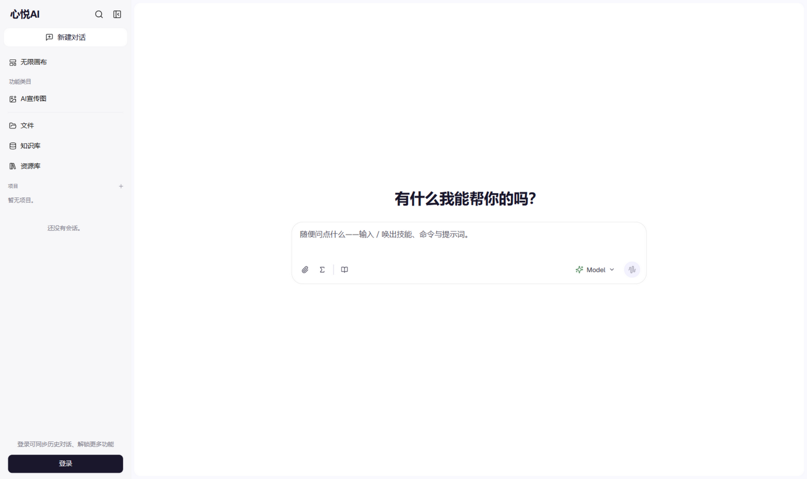
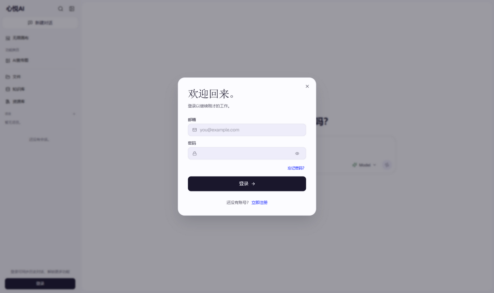

# 心悦AI助手 · Xinyue AI Assistant

> 基于 [Aivory](https://github.com/hjxwz123/Aivory)（Apache-2.0）二次开发，界面品牌与默认站点名已改为「心悦AI」，其余能力与部署方式跟随上游。感谢上游作者的出色工作。

一个容器跑起来的自部署多模型 AI 工作空间：多模型对话、多轮工具调用、知识库、代码沙箱、团队空间、订阅配额和管理后台，全部开箱即用。



## 界面预览

| 工作台 | 登录 |
| --- | --- |
|  |  |

## 功能一览

| | 能力 | 说明 |
|---|---|---|
| 💬 | **多模型对话** | 同一界面使用 Claude、GPT、Gemini 或任意 OpenAI 兼容接口；渠道与密钥统一在管理后台配置，可按消息切换模型 |
| 🛠 | **多轮工具调用** | 网络搜索、网页抓取、Python、图片生成、记忆、技能模板自动串联（默认单轮合计 48 次），一条消息端到端完成任务 |
| 📚 | **知识库（RAG）** | 支持 PDF / Office / Markdown / 表格 / 图片，结构感知分块；配置向量库走混合检索，未配置自动回退全文注入，回答带引用 |
| 🐍 | **Python 沙箱（可选）** | 每个对话一个隔离工作区，预装 pandas、matplotlib、python-pptx 等，产出的图表和文档自动显示为下载卡片；未部署沙箱时以算术安全模式兜底 |
| 👥 | **团队空间** | 共享对话、文件与知识库，支持邀请链接、成员署名与空间管理 |
| 💳 | **订阅与配额** | 用户层级、每日额度、积分与兑换码，可选支付结算 |
| 🛡 | **管理后台** | 渠道、模型、工具、用户、知识库、订阅、备份与系统设置集中管理 |

## 快速开始（单容器）

**不需要预先安装 PostgreSQL / Redis / Qdrant**：不设置这些服务地址时，应用自动使用内嵌 SQLite、进程内缓存与全文检索兜底。

```bash
git clone https://github.com/qiantingwl/xinyueai-assistant.git
cd xinyueai-assistant

# 构建镜像（Vite 前端 + Go 后端打包进同一个容器）
docker build -f deploy/Dockerfile.app -t xinyueai-assistant:latest .

# 运行
docker run -d --name xinyueai-assistant \
  -p 8787:8787 \
  -v xinyueai-data:/app/data \
  -e JWT_SECRET="$(openssl rand -hex 32)" \
  -e ENABLE_MOCK_PROVIDER=true \
  xinyueai-assistant:latest
```

启动后打开 `http://localhost:8787`：

1. 首次访问进入初始化页，**第一个注册的账号自动成为管理员**
2. 进入管理后台 `/admin/channels`，添加模型渠道（填 API 地址和 Key），再创建至少一个聊天模型
3. 开着 `ENABLE_MOCK_PROVIDER=true` 时自带 Mock 模型——不配真实 Key 也能先把完整流程跑一遍

对话记录、上传文件和生成产物都存在 `xinyueai-data` 卷里，升级镜像不丢数据。

## 常用环境变量

完整清单见 [.env.example](.env.example)。最常用的几个：

| 变量 | 默认 | 说明 |
|---|---|---|
| `JWT_SECRET` | 内置示例值（**生产必改**） | 登录令牌签名密钥，建议 32 字节以上随机串 |
| `ENABLE_MOCK_PROVIDER` | `true` | 种子一个 Mock 渠道便于开箱体验，接入真实模型后可设为 `false` |
| `DATABASE_URL` | 内嵌 SQLite 文件 | 设为 `postgres://...` 即切换到 PostgreSQL |
| `REDIS_URL` | 未启用 | 设置后用 Redis 做缓存、限流与跨进程流式通知 |
| `QDRANT_URL` | 未启用 | 设置后启用向量检索（RAG 混合检索 + 动态 Top-K） |
| `SANDBOX_BASE_URL` / `SANDBOX_API_KEY` | 未启用 | 指向沙箱 sidecar 后开放完整 Python 代码执行 |
| `SEARCH_PROVIDER` / `SEARCH_API_KEY` | 未启用 | 接入 Serper 或 Brave 后开放联网搜索，否则该工具返回占位结果 |
| `DAILY_MESSAGE_LIMIT` | `200` | 每用户每日消息配额 |

数据库表结构由应用启动时自动创建和迁移，不需要手动执行 SQL。

## 升级

```bash
git pull
docker build -f deploy/Dockerfile.app -t xinyueai-assistant:latest .
docker rm -f xinyueai-assistant
# 用与首次相同的 docker run 命令重新启动
```

## 技术栈

React 19 + Vite + TypeScript · Tailwind CSS 4 · Go 1.24 · SQLite / PostgreSQL · 可选 Redis 与 Qdrant

## License

[Apache-2.0](LICENSE)
